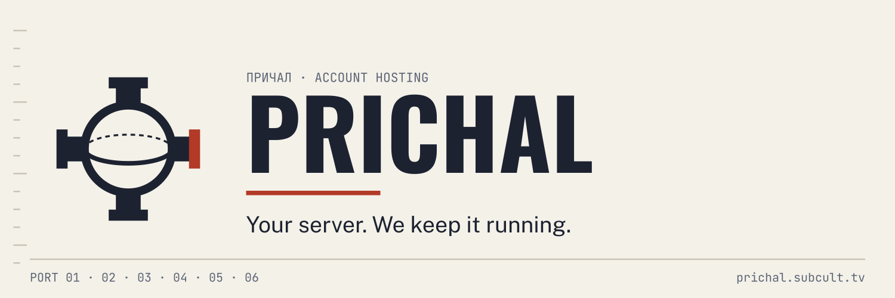

# Prichal

> Private preview. Public account hosting and sign-up are not available.

**Your server. We keep it running.**

Every account on the open social web lives on a server somewhere. Prichal is
being built to give yours a server of its own, with the upkeep handled for
you. You keep posting from Bluesky.

**Status: private preview. Public account hosting and sign-up are not available.**

[Read about Prichal](https://subcult.tv/products/prichal) · [Follow the work](https://git.subcult.tv/subculture-collective/prichal/issues)

## A home for your account

The intended service has one job: run your account's home server. Browser
onboarding is the first delivery path. A separate management interface handles
the hosting work; the account server holds the public records and media.

Posts on the network are public wherever the server runs. Hosting an account
does not make its posts private, and each app still decides what it shows.

## The door is closed while we test

The repository includes the management application, owner sign-in and local
runtime checks. The hosted preview serves the landing page and management
interface; it does not host public accounts. Backups, recovery, public
federation, domains and account migration have their own qualification gates.

Dock your account. We handle the rest. That is the offer we're working toward,
not an invitation to sign up today.

For the implementation and release gates, read the
[roadmap](docs/roadmap.md). For local setup and the preserved technical
overview, read [DEVELOPMENT.md](DEVELOPMENT.md). The
[product brand guide](brand/GUIDE.md) records the messaging rules.

Prichal is built by [SUBCULT](https://subcult.tv). The repository is now
`subculture-collective/prichal`; some internal service identifiers retain
`pds-ass`.

## License

Original contributions in this repository are licensed under the GNU General
Public License, version 3 or (at your option) any later version
(`GPL-3.0-or-later`). See [LICENSE](LICENSE).

Third-party code, documentation, fonts, data, and other assets retain their own
licenses, copyright notices, and attribution. This license does not replace
those terms or grant rights to upstream material that its authors have not granted.
