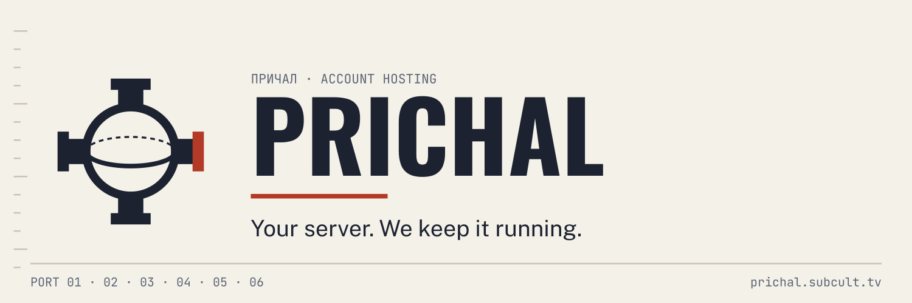

# Prichal



**Your server. We keep it running.**

Every account on the open social web lives on a server somewhere, called a
personal data server (PDS). Prichal is managed hosting for that server: you get
one of your own, and we do the maintenance. You keep posting from Bluesky.

Prichal is a private preview. Public account hosting and sign-up are not
available. Posts on the network are public wherever the server runs; hosting an
account does not make its posts private.

Preview site: [prichal.subcult.tv](https://prichal.subcult.tv)

## Features

This repository holds the management service, the agent that runs on hosting
machines and the public landing page. Much of it runs today only in local
development and private staging.

- **Owner sign-in** through OpenID Connect, with sessions and CSRF protection.
- **Organizations** with scoped member roles, expiring invitations, member
  removal and ownership handover.
- **Deployments.** An owner names a server and requests it. A background worker
  places it on a hosting node, where the node agent runs the official Bluesky
  PDS container behind Caddy. Retried requests reuse the original operation.
- **First account and handle.** Set up the first account on a new server with
  a handle on a provider-managed domain.
- **Custom hostnames (planned).** The management app can record a hostname
  choice and prepare a DNS TXT ownership check; this is not offered yet.
- **Exports and hosting exit.** Owners can export their data and end a hosting
  service with a retention window for recovery or migration.
- **Customer CLI.** `pds-ass` signs in through the browser and lists, deploys
  and checks servers. Binaries can be built locally; none are published.
- **Support and history.** A support workspace and a lifecycle history of each
  server's changes.

Moving an existing account to Prichal, account backups and public federation
are still in development.

## Quick start

You need Go 1.27, Node.js 24.15, pnpm 12.6, Docker with Compose, Bash and
OpenSSL.

```sh
cd web && pnpm install --frozen-lockfile && cd ..
./scripts/dev.sh db        # local PostgreSQL on 127.0.0.1:35433
```

Then, in four terminals:

```sh
./scripts/dev.sh issuer    # local OIDC test issuer
./scripts/dev.sh api       # Go API on 127.0.0.1:8080
./scripts/dev.sh web       # management interface on http://localhost:5173
./scripts/dev.sh worker    # background jobs (local test provisioner)
```

`scripts/dev.sh db` writes a generated database password to the ignored
`.local/local.env` file. Stop the database with `./scripts/dev.sh down`; this
keeps its data volume.

Run the checks:

```sh
./scripts/dev.sh smoke
```

This runs the script contract tests, builds the web interface, and runs `go vet`
and the Go tests with the race detector against a disposable database. See
[docs/local-development.md](docs/local-development.md) for more detail and
[docs/local-pds-runtime.md](docs/local-pds-runtime.md) for running the upstream
PDS container locally.

## Configuration

The API and worker read environment variables:

- `PDS_MODE`: `local` for development
- `PDS_DATABASE_URL`: PostgreSQL connection string
- `PDS_LISTEN_ADDRESS`: API listen address
- `PDS_PUBLIC_ORIGIN`: public origin of the management interface
- `PDS_OIDC_ISSUER`, `PDS_OIDC_CLIENT_ID`, `PDS_OIDC_CLIENT_SECRET`: owner
  sign-in
- `PDS_ENROLLMENT_KEY_FILE`: key used to encrypt account invitations
- `PDS_WORKER_AGENT_CA_FILE`, `PDS_WORKER_AGENT_CERT_FILE`,
  `PDS_WORKER_AGENT_KEY_FILE`: mutual TLS between the worker and node agents

`scripts/dev.sh` sets local defaults for all of these.

## Deploy

`deploy/production/` has a Compose file for the management service: PostgreSQL,
the API image (`api.Dockerfile`), the web image (`web.Dockerfile`) and a Caddy
configuration. Only the web listener is published; PostgreSQL and the API stay
on an internal network. Secrets come from an env file you provide. The static
landing page is in `site/`.

## Project layout

- `backend/`: Go module. `cmd/api`, `cmd/worker` and `cmd/node-agent` are the
  services; `cmd/pds-ass` is the customer CLI; the other `cmd/*-admin`
  commands are operator tools.
- `web/`: React and TypeScript management interface (Vite)
- `site/`: static landing page
- `deploy/`: Compose files, Dockerfiles and Caddy configuration
- `scripts/`: local development, smoke tests and contract tests
- `brand/`: [brand guide](brand/GUIDE.md)
- `docs/`: design notes and local setup guides, including the
  [implementation plan](docs/implementation-plan.md) and the
  [roadmap and release gates](docs/roadmap.md)

Some identifiers still use the project's earlier name, `pds-ass` (the Go
module, the CLI and the local Compose project).

## Contributing

Report bugs and request features in [GitHub issues](https://github.com/subculture-collective/prichal/issues).
Ask questions and share ideas in [GitHub Discussions](https://github.com/subculture-collective/prichal/discussions).

Send code as a pull request on GitHub against `main`. CI runs the Go, web and database
smoke test, the deploy script tests and alert rule checks, and builds the web
image on every pull request.

## License

Original contributions in this repository are licensed under the GNU General
Public License, version 3 or (at your option) any later version
(`GPL-3.0-or-later`). See [LICENSE](LICENSE).

Third-party code, documentation, fonts, data and other assets keep their own
licenses, copyright notices and attribution.

Built by [SUBCULT](https://subcult.tv).
