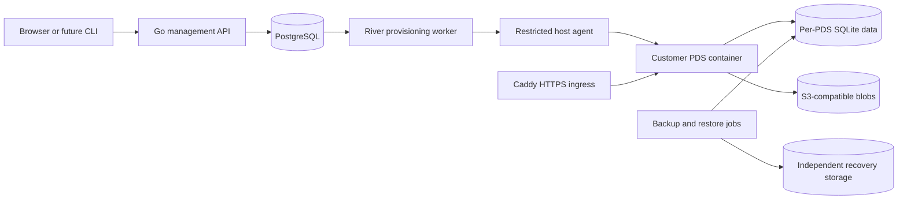

# Standalone managed PDS implementation plan

Status: planned. Updated September 30, 2026.

## Product and success criteria

Build a service where a creator or organization signs in, selects a supported plan and region, names a PDS, and receives a working HTTPS endpoint on our infrastructure. We operate its runtime, storage, updates, backups, and recovery. The customer needs no cloud account, Docker installation, or administrator credentials.

This product is independent of Subcult OS and Patchwork. They can become API consumers later; their code, databases, authentication, and deployment workflows are not dependencies. npm was an example of convenient onboarding, not a required technology or distribution channel.

The first supported path is browser onboarding for a new account on a provider-managed domain. A Go CLI can follow once the same API is stable. BYO domain handles are included before the paid pilot. Custom PDS endpoints and existing-account migration are later extensions.

The readiness target is 15 minutes. Track both deployment submission to a usable endpoint and the complete onboarding journey through first-account login. Record queue waits, TLS work, failures, retries, and human steps separately. Report the tested environment and sample size. Do not silently count failed attempts out of timing results or equate an HTTP health response with federation working.

## Architecture

### Recommended stack

| Component | Initial choice | Boundary |
| --- | --- | --- |
| Management API and workers | Go | Authentication, authorization, deployment intent, reconciliation, and customer-visible state |
| Management database | PostgreSQL with pgx | Organizations, PDS instances, host inventory, entitlements, operations, and audit events |
| Durable work | River on PostgreSQL | Transactional enqueueing and bounded retries; external effects still require idempotency |
| Customer interface | React, TypeScript, Vite | Login, deployment wizard, status, domains, usage, recovery and billing links |
| PDS runtime | Official Bluesky container pinned by digest | Existing protocol implementation with its own SQLite databases; one active writer per PDS |
| Execution | Docker and explicit Compose/runtime manifests on Ubuntu VMs | Separate credentials, volumes, networks and resource limits per PDS |
| Ingress | Caddy | Allowlisted tenant hostnames, managed HTTPS and working WebSockets |
| Fleet provisioning | OpenTofu and Ansible | Repeatable hosts, networks, firewall rules, storage and agent installation |
| Blob storage | S3-compatible object storage | Tenant-scoped credentials and access; public referenced media remains distinct from backups |
| Recovery | SQLite-aware backups, PostgreSQL recovery, independent object copies | Prove full restores including identity material and referenced media |
| Secrets | SOPS for configuration; protected runtime and identity key custody | No secrets in job payloads, browser output, logs, committed state, or public exports |
| Delivery and operations | Gitea CI, container registry, Tailscale administration, external monitoring | Controlled releases, private administration, recovery alerts and incident evidence |

Start with a small, prepared fleet in one region. Allocate a PDS container on an existing host rather than installing a machine during every customer request. This is managed container isolation, not a promise of a dedicated VM or automatic high availability. Capacity limits must come from measurements.

DigitalOcean is the initial planning assumption. Confirm provider, region, purchased domains, budget, secret custody and backup destination in the infrastructure bootstrap issue before spending money. Keep provider operations behind adapters; build one real provider first. The homelab can support development and staging, but commercial operation must not depend on the workstation or on an unqualified home-network path.

### Identity and domain boundaries

Management login is separate from a customer's AT account. Use a standards-based OIDC flow for the first browser implementation, with a configured production identity provider and a local test provider. Store issuer/subject identity, session state and organization membership; do not merge identities from matching email or DID text. The first pilot has an owner role. Later organization roles remain separate from PDS account permissions.

Choose a separate registered domain for hosted PDS endpoints and the management application. Keep the PDS hostname stable once accounts exist. BYO handle verification changes the account's handle, not its hosting endpoint. A custom PDS domain must be verified before accounts are created; changing it later requires an explicit migration.

The browser uses a short-lived, tenant-scoped enrollment path to help a customer create the first verified PDS account. Invite codes remain enabled. Customer PDS passwords and administrator keys must not become management API credentials. Give account-level actions their own authorization and validation.

See [AT production guidance](https://atproto.com/guides/going-to-production), [account migration](https://atproto.com/guides/account-migration), [account recovery](https://atproto.com/guides/account-recovery), and [OIDC Core](https://openid.net/specs/openid-connect-core-1_0.html).

### Deployment and recovery behavior

Persist a deployment intent and its job in one database transaction. Accept an organization-scoped idempotency key. Show stages such as queued, allocating, configuring, starting, checking, ready, and failed. Suspension and deletion are separate lifecycle operations. Billing state is separate from runtime state.

Every external operation must reconcile by stable instance/operation identifier before retrying. A timeout can leave a running container even when the worker has not saved its result. Returning to the browser or retrying an API request must recover the same deployment, not allocate another billable instance. Bounded retries end in a diagnosable operator action. Never delete data automatically to compensate for an uncertain provisioning result.

The public API does not receive Docker sockets or fleet administrator credentials. A separate worker talks to an authenticated host agent over private administration networking. The agent accepts only defined lifecycle operations for pinned PDS images and service-owned resources. It cannot execute customer-provided shell commands, images, Compose files, or arbitrary volume paths.

Ready means a verified HTTPS route, functioning PDS health and WebSocket transport, durable state and correct storage configuration. First-account authentication, signed record creation, blob readback and downstream indexing are additional explicitly measured checks. Downstream federation delays must appear as pending verification rather than a fabricated success.

Store recovery metadata, key custody information and consistent database/blob inventories. Rehearse recovery to a fresh host while retaining the original PDS hostname and preventing two active writers. Initial engineering targets are at most 15 minutes of recoverable data loss and recovery within 60 minutes for the bounded pilot. These targets require measurements before customer commitments.

Use [River's transactional jobs](https://riverqueue.com/docs) while implementing operation-specific reconciliation. PostgreSQL/River restoration must reconcile live host inventory before processing recovered jobs.

## Delivery sequence

The [roadmap](roadmap.md) groups independently demonstrable issues into release gates. Each issue includes its behavior, acceptance checks, verification, blockers and boundaries. Implement the unblocked frontier rather than treating milestone order as an extra dependency.

1. Make the local browser/API/database slice runnable and qualify a disposable PDS runtime.
2. Bootstrap a staging host and prove resumable operator provisioning from the management service.
3. Deliver browser deployment, HTTPS, first-account onboarding, federation checks and BYO handles.
4. Prove identity custody, backups, restores, monitoring, controlled upgrades, isolation and suspension.
5. Add subscription entitlements, usage controls, capacity operations, exports and support workflows for a paid pilot.
6. Measure timing and repeat use, qualify the production environment, and open public signup only after the release gate passes.
7. Add optional CLI delivery, custom PDS domains, account migration and organization collaboration as separate extensions.

Commit checkpoints should match these demonstrated behaviors. Keep source changes and configuration changes reviewable; stage container upgrades on a disposable PDS before production rollout. Paid-account or identity changes need explicit before/after evidence, with no secret values in artifacts.

## Verification and rollout

- Run Go unit and database integration tests against disposable PostgreSQL; use browser tests for actual onboarding, status, domain and billing journeys.
- Exercise duplicate requests, job crashes after external success, lost responses, expired enrollment, exhausted capacity, certificate failure and database recovery. Verify no extra instance, billable action or cross-tenant disclosure occurs.
- Use local or controlled test identities in automation. Live PLC operations, public records, paid charges and customer email are qualified separately with designated staging accounts and test-mode billing.
- Verify read, write, blob, and WebSocket behavior through the public route. An HTTP health check alone is insufficient.
- Recover a populated PDS and the management database; compare inventories and prove new writes, identity continuity, single-writer behavior and federation after restoration.
- Start with operator-invited test customers. Require M2 recovery/isolation gates and M3 billing/exit gates before taking paid pilot traffic. Keep public signup closed until M4.
- Roll back application releases through pinned images and migration compatibility rules. If a PDS upgrade changes SQLite schemas incompatibly, recover a compatible snapshot rather than merely launching an older image against modified data.
- Keep suspend, cancellation, export, deletion scheduling and restore actions distinct. Cancellation must not trigger immediate irreversible data deletion.

## Decisions still required

Cloud account and region, actual product/domains, identity provider, key-management mechanism, support hours, storage/account allowances, prices and retention periods remain unselected. Their implementation issues include decision checkpoints. This plan authorizes no provisioning expenditure, customer migration, public publication, or deletion operation by itself.

Earlier feasibility notes remain historical research. Their organization-application scope, proposed prices and TypeScript-specific queue suggestions do not override this plan. This plan contains no implementation or verified deployment-time result.
